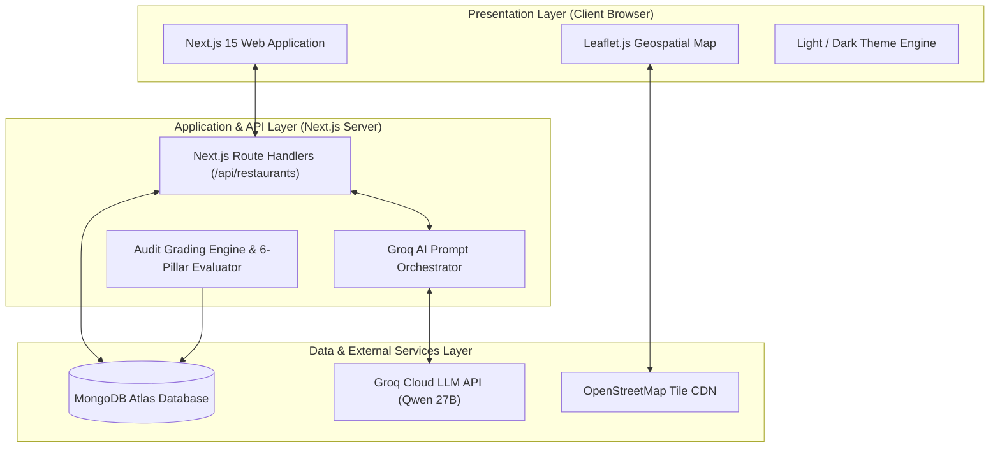

# Kitchen Audit Hub — Final Project Review Presentation Deck
**Standard Project Presentation | CRT – Batch A**  
*Document for copy-pasting directly into the presentation slide template.*

---

## Slide 0: Title Slide (Cover)

* **Badge / Eyebrow:** `FINAL PROJECT REVIEW`
* **Project Title:** `KITCHEN AUDIT HUB`
* **One-Line Description:**  
  `A Public-Facing Hygiene Transparency Platform & Geospatial Directory for Food Safety Inspections`
* **Team Details:**
  * **Team Name:** `[Your Team Name]`
  * **Team Members:** `[Member 1, Member 2, Member 3, Member 4]`
  * **Department:** `Department of Computer Science & Engineering`
  * **Guide / Mentor:** `[Mentor / Faculty Guide Name]`
  * **Institution:** `CRT – BATCH 1 | [Institution / College Name]`

---

## Slide 1: Problem Statement (Slide 02)

### 📌 THE PROBLEM
* **What problem are you trying to solve?**  
  Popular food delivery platforms (Swiggy, Zomato) only showcase taste ratings, food photography, and delivery speed. Consumers are completely blind to back-of-house kitchen hygiene, food storage practices, and sanitary compliance.
* **Who faces this problem?**  
  Everyday consumers, families, students, and diners ordering food online or dining out across urban hubs like Hyderabad.
* **Why is solving it important?**  
  Official health inspections routinely uncover hazardous violations—such as rodent infestations, ambient chicken thawing at 84°F, and severe cross-contamination. Because these records are locked in dense, inaccessible government PDF portals, consumers unknowingly consume contaminated food, leading to preventable foodborne illnesses.

### 💡 YOUR SOLUTION
* **How does your project solve the problem?**  
  **Kitchen Audit Hub** aggregates official municipal inspection records (FSSAI/GHMC), normalizes them into a standardized 4-tier health grade scale (Grade A to Failed), and delivers instant clarity through an interactive map, plain-language Groq AI health summaries, and real-time violation alerts.
* **Who will benefit from your solution?**  
  * **Consumers & Families:** Gain instant transparency to choose safe, hygienic food establishments.
  * **Compliant Restaurants:** Earn consumer trust and commercial visibility for maintaining high standards.
  * **Food Safety Authorities:** Receive crowd-sourced inspection leads to prioritize audits.

---

## Slide 2: Technology Stack & Key Features (Slide 03)

### 🛠️ TECHNOLOGY STACK
* **Frontend:** Next.js 15 (App Router), React 19, TypeScript, Vanilla CSS Custom Design System, Lucide Icons, Leaflet.js
* **Backend:** Next.js Route Handlers & Server Components (Node.js runtime)
* **Database:** MongoDB Atlas with Mongoose ODM (real Hyderabad establishment & audit history schemas)
* **AI Tools / APIs:** Groq Cloud SDK (`qwen/qwen3.8-27b` / Llama-3) for AI Food Safety Summaries; OpenStreetMap Tile Network
* **Development & Deployment:** Google Antigravity IDE, Git/GitHub, Vercel Cloud Platform (CI/CD)

### 🌟 KEY FEATURES
1. **Verified 4-Tier Health Grading & 6 Safety Pillars:**  
   Translates raw audit scores into standardized Grades (A, B, C, Failed) with detailed breakdowns across Food Handling, Temperature Control, Cold Storage, Kitchen Hygiene, Pest Control, and Employee Hygiene.
2. **Interactive Geospatial Map with Dark/Light Support:**  
   Real-time map across 10 Hyderabad localities (Jubilee Hills, Banjara Hills, Gachibowli, etc.) with color-coded pins, distance tracking, and instant audit preview cards.
3. **Groq-Powered AI Health Summaries:**  
   Converts multi-page technical inspection logs and violation citations into 3-sentence, plain-language consumer verdicts.
4. **Live Hygiene Alerts, Community Reporting & Custom Settings:**  
   Real-time notification dropdown for recent violations, community lead intake form (`/contact`) with GHMC helpline integration, and customizable safety alert thresholds (`/settings`).

---

## Slide 3: Project Workflow & System Architecture (Slide 04)

### A. PROJECT WORKFLOW

```
┌─────────────────┐      ┌─────────────────────────┐      ┌────────────────────────┐      ┌────────────────────────┐
│    1. INPUT     │ ───► │       2. PROCESS        │ ───► │      3. DATA / AI      │ ───► │       4. OUTPUT        │
│                 │      │                         │      │                        │      │                        │
│ • Official GHMC │      │ • Next.js Normalizer    │      │ • MongoDB Atlas        │      │ • Responsive Directory │
│   Audit Logs    │      │ • Score Calculation     │      │   Establishment Models │      │ • Interactive OSM Map  │
│ • User Searches │      │ • 6-Pillar Evaluator    │      │ • Groq AI LLM Engine   │      │ • AI Safety Summaries  │
│ • Consumer Lead │      │ • Locality & Distance   │      │   (Plain Text Verdict) │      │ • Real-Time Alert Bell │
│   Submissions   │      │   Geo-Indexing          │      │ • OpenStreetMap Tiles  │      │ • Lead Intake Receipts │
└─────────────────┘      └─────────────────────────┘      └────────────────────────┘      └────────────────────────┘
```

### B. SIMPLE SYSTEM ARCHITECTURE (Mermaid Diagram)

*Copy-paste this block into any Mermaid editor or presentation slide:*



---

## Slide 4: Project Screenshots / Output (Slide 05)

### 📸 SCREENSHOT 1: MAIN PAGE / INPUT (Dashboard & Geospatial Map)
* **Image to Insert:** `Map View (Light / Dark Mode with Hyderabad Pins)` or `Dashboard Hero`
* **What it demonstrates:**  
  Consumers can search restaurants across Hyderabad, filter by locality chips (*Banjara Hills, Jubilee Hills, Gachibowli*), and immediately visualize food safety across their neighborhood via color-coded map pins (Emerald Grade A, Amber Grade B, Orange Grade C, Crimson Grade F).

### 📸 SCREENSHOT 2: MAIN FEATURE (The Contrast: Verified Grade A vs. Critical Grade F)
* **Image to Insert:** Side-by-side: `Tatva Fine Dining (Grade A · 98%)` vs. `Street Wok Express (Grade F · 56%)`
* **What it demonstrates:**  
  Exposes the stark reality hidden behind delivery app star ratings. While Tatva maintains 100% pest control and clean routine audits, Street Wok Express has 4 open critical violations cited by inspectors—including raw chicken thawing at 84°F and active rodent droppings.

### 📸 SCREENSHOT 3: OUTPUT (Groq AI Health Summary & Live Alert Notifications)
* **Image to Insert:** `AI Health Summary Card` + `Header Notification Dropdown Open`
* **What it demonstrates:**  
  Shows the intelligent consumer translation layer. The Groq LLM synthesizes technical inspection logs into a 3-sentence verdict (*"Safe to order"* or *"Urgent safety lapse warning"*), while the header notification bell broadcasts real-time Hyderabad audit updates.

---

## Slide 5: Team Members & Contributions (Slide 05)

| TEAM MEMBER | TASK / MODULE | WHAT THEY CONTRIBUTED |
|---|---|---|
| **[Team Member 1 Name]** | **Frontend Architecture & UX Design** | Designed the responsive Next.js 15 App Router architecture, custom CSS design system, dark/light theme engine, and mobile-first drawer navigation. |
| **[Team Member 2 Name]** | **Backend APIs & Database Architecture** | Built MongoDB Atlas schemas (Restaurant, InspectionRecord, Violations), developed RESTful route handlers (`/api/restaurants`), and dynamic database seeding. |
| **[Team Member 3 Name]** | **AI Integration & Food Safety Logic** | Implemented the Groq SDK pipeline with specialized prompt engineering to translate official violation records into certified 3-sentence consumer health summaries. |
| **[Team Member 4 Name]** | **Geospatial Mapping & Quality Assurance** | Integrated Leaflet.js interactive OpenStreetMap with custom SVG grade pins, locality filtering, end-to-end testing, and Vercel cloud deployment. |

*(Replace bracketed names with your actual team members.)*

---

## Slide 6: AI Project Video & Conclusion (Slide 06)

### 🎥 MANDATORY AI VIDEO SUBMISSION (Duration: 2–3 Minutes)
* **Video Should Show:**
  * **Problem & Solution:** The delivery app blindspot vs. Kitchen Audit Hub transparency.
  * **Main Features & Workflow:** Locality map filtering, 6 safety pillars, and standardized grading.
  * **Project Demo & Output:** High-contrast audit comparisons (Tatva vs. Street Wok) and AI summaries.
  * **Benefits & Conclusion:** Consumer health protection and call-to-action.
* **AI Video Link / File Name:**  
  `Kitchen_Audit_Hub_Promotional_Video.mp4` / `[Your Google Drive / YouTube Video Link]`

---

### 🎯 FINAL SUMMARY
* **What does your project achieve?**  
  Kitchen Audit Hub democratizes buried municipal food safety data across Hyderabad. It transforms complex government PDFs into an intuitive, accessible web directory powered by AI summaries and geospatial mapping.
* **What is its main benefit?**  
  It empowers everyday consumers to make informed, safe dining decisions—preventing foodborne illness, protecting families, and motivating restaurant owners to uphold high sanitary standards.

### 👏 Thank You | Questions & Answers
* **Live Web App:** `kitchenaudithub.in` *(or your Vercel deployment URL)*
* **Source Code:** `github.com/bhargav-kv-05/Kitchen-Audit-Hub`
